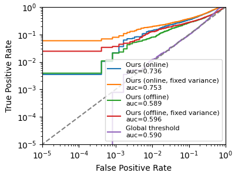

# Membership Inference Attacks from First Principles (LiRA)

PyTorch-based reproduction of the Likelihood Ratio Attack LiRA as described in ["Membership Inference Attacks From First Principles"](https://arxiv.org/abs/2112.03570), Carlini et. al, 2022

### Overview
Membership Inference Attacks aim to determine if a specific data sample was used to train a machine learning model. The LiRA method uses a series of shadow models to learn the distribution of losses for specific examples. By modeling these distributions as Gaussians and performing a Likelihood Ratio Test, the attack can confidently identify members even at extremely low False Positive Rates, where traditional "global threshold" attacks typically fail.

### Experiment Results
The following results were obtained using a WideResNet-28-2 architecture trained on the CIFAR-10 dataset. The evaluation focuses on the True Positive Rate at a strict 0.1% False Positive Rate, which is the recommended metric for measuring high-confidence privacy violations.

Attack Variant| AUC |	Accuracy	| TPR @ 0.1% FPR
--------------|-----|---------|---------------
Offline |	58.85	| 58.58	| 2.11
Offline (Fixed Variance) |	59.64| 58.91	| 3.67
Global Threshold |	58.98 | 61.69 |	0.08

